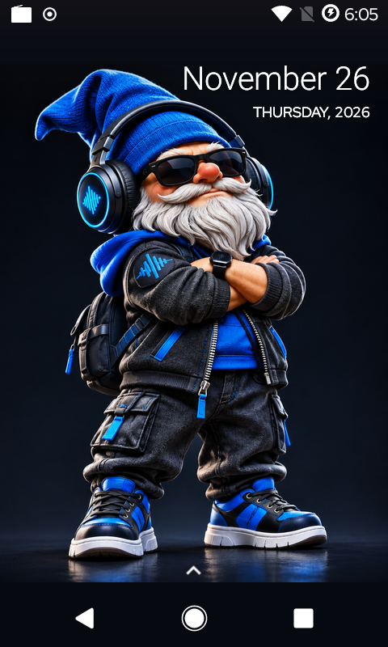
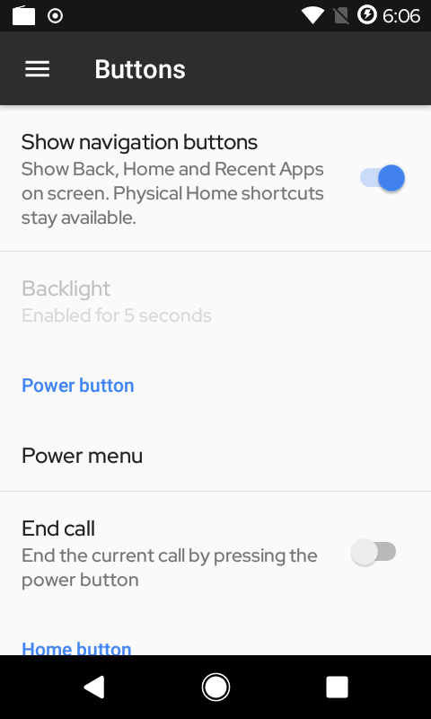
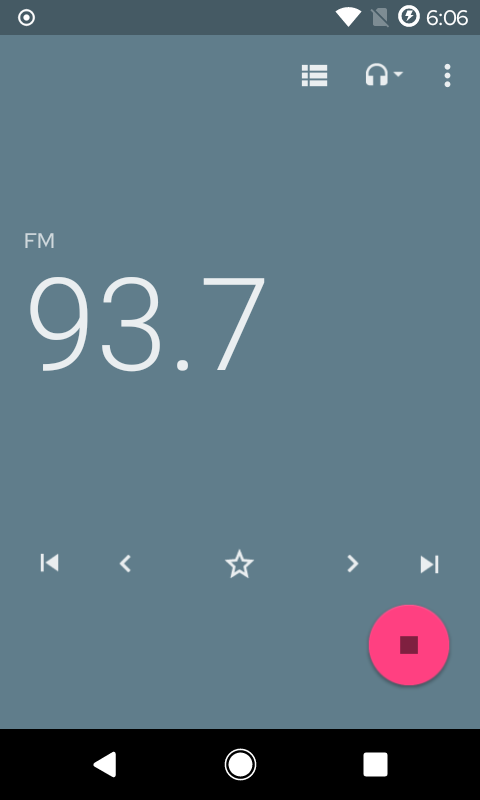

# Lithium 7 for Q5 Gen 7 (Q5 Mint)

Android 7.1.2 for the **TIMMKOO Q5 Gen 7**, also called **Q5 Mint**. This port
brings the Mint-style Q5's touchscreen, Home button, speaker and FM radio to
Lithium 7, with a blue DJ gnome boot screen and wallpaper.

**[v1.0.1 release](https://github.com/yetisoldier/timmkoo-q5-lithium7-fork/releases/tag/v1.0.1)** ·
[Download firmware](https://github.com/yetisoldier/timmkoo-q5-lithium7-fork/releases/download/v1.0.1/Q5-Gen7-Lithium7-v1.0.1.zip) ·
[Installation](docs/INSTALL.md) · [Release notes](docs/releases/v1.0.1.md)

## Is this for my Q5?

For the **Mint-style MT6582 model with one circular Home button below the
screen**. The tested unit is the 2026 mint-green Q5 Gen 7. Color or the Q5 name
alone does not establish compatibility. **Do not install on MT6580, MT6735,
older multi-button Q5s or an unidentified hardware revision.**

| Hardware | Supported profile |
|---|---|
| Platform | MediaTek MT6582, ARMv7 / Cortex-A7 |
| Memory | 1 GB RAM; approximately 8 GB internal flash before system partitions |
| Display | 480 × 800 portrait touchscreen |
| Controls | Single front Home circle; side power/volume controls |
| Audio | Built-in speaker, wired 3.5 mm headphones and microphone |
| FM | MT6627 receiver; wired headphones serve as the antenna |
| Storage | Internal storage and microSD |
| USB | Charging, ADB and selectable MTP file transfer |
| Camera | No support; no fitted camera sensor was established |

This is community firmware, not a manufacturer update. Check your hardware
and Mint partition layout before flashing.

## Features

- Working touch, physical Home, speaker and wired headphone playback.
- **Home shortcuts:** tap Home, double-tap Back, hold Recent Apps.
- On-screen Back/Home/Recents **visible by default**. Change **Settings →
  Buttons → Show navigation buttons**; physical Home assignments remain editable.
- FM Radio with headphone audio, working volume buttons and pause/resume.
- Audio Recorder for spoken recordings and playback.
- Hardware H.264 playback tested at 720p; the tested 1080p file uses software
  decoding. Other formats/profiles depend on their codecs.
- USB file transfer: select **Transfer files** from the USB connection options.
- Wi-Fi with a persistent fallback address and bounded startup reconnection recovery.
- Wi-Fi-only configuration: cellular modem services and SIM/call lock-screen notices disabled.
- Internal/microSD storage and Android music/gallery tools.
- Blue gnome boot artwork/default wallpaper; the false Lawnfeed prompt removed.
- Jelly, HTMLViewer, Open Camera and Xposed Installer removed from defaults.
  Embedded WebView remains for app connection screens.
- Hidden Plex sign-in window for compatible clients, tested with Saga. It has
  no launcher icon or address bar and accepts only supported Plex auth URLs.

## Screenshots

Taken from the clean v1.0.0 installation on the tested Q5.

  
  
  

## Installation

Download **Q5-Gen7-Lithium7-v1.0.1.zip** from Releases and check its SHA-256
against the accompanying checksum file. GitHub's automatic **Source code**
downloads are not flashable firmware.

Existing official v1.0.0 installations can use the documented **data-preserving
upgrade**. Back up first. Moving from Mint or another ROM requires a clean install.

**A clean installation erases internal apps, logins, recordings and files.**
Formatting internal data also destroys adopted microSD decryption keys. Back
up what you need and remove portable cards before flashing another unit.

The bundle contains boot/system/logo images, a restricted MT6582 scatter and
an ADB/recovery installer. Only **BOOTIMG, ANDROID and LOGO** are selected.
No preloader, bootloader, partition table, recovery, userdata, NVRAM or
calibration image is included.

Follow the [installation guide](docs/INSTALL.md) for the tested ADB/TWRP method
or the SP Flash Tool alternative. **Never choose Format All or Firmware
Upgrade, or add a preloader from another package.** This is an image bundle,
not a ZIP to install through TWRP's Install ZIP screen.

## First use and optional apps

Allow several minutes for first boot and finish Android setup. Copy music to
internal storage or a portable microSD card. For USB copying, unlock the Q5
and choose **Transfer files**. Plug headphones in before opening FM Radio.

Audiobookshelf, Plexamp and Apple Music are **optional, not bundled**. Install
Android 7-compatible versions from legitimate sources. Audiobookshelf's
connection layout was checked with the included WebView: **Connect → full
server URL → Submit → sign in**. Server authentication, streaming, offline
books and subscription/DRM playback depend on your app version and service.
Google Play services are not bundled.

On the tested Apple Music 4.7.2 installation, turning Motion off and Reduce
Player Motion on avoided the animated-artwork codec failure. Keep Android
animation scales off for this slow device; use a Flat background in Plexamp.
These optional app preferences belong to your account/install and are not
firmware-bundled settings. Saga supports library selection but has no Plex
Home profile picker in the tested 1.2.0 release.

Browser removal does not block networking inside other apps or prevent
sideloading. This firmware is not a parental-control system.

## Known limits

The owner confirmed touch, Home, speaker, wired headphones, microphone
recording/playback and FM headphone reception. USB transfer, network access,
storage and the stated video cases were also tested. This first release does
not claim every Android feature or third-party app has been validated.

- The inherited Settings > Notification Drawer customization screen has a
  recorded crash; its repair remains open.
- Bluetooth discovery works; paired audio, reconnect and headset buttons need
  a physical headset test.
- FM speaker/Bluetooth output and a full station scan remain unverified.
- Low-battery charging, battery life and unplugged deep sleep need longer tests.
- Rotation, light/proximity behavior and camera operation are not established.
- Android 7.1.2 and WebView 119 are legacy software. The inherited security
  patch label is **2018-04-05**; this port does not provide current Android
  security maintenance. The base remains a userdebug build.
- Xposed Installer is removed and no fixes require it. Inactive legacy files
  remain; a full framework removal is not claimed.

## Help and source

[Report an issue](https://github.com/yetisoldier/timmkoo-q5-lithium7-fork/issues)
with your hardware, release version, reproduction steps and whether the same
feature works in Mint. Do not post passwords, tokens, calibration dumps or
private recordings.

See [BUILDING.md](docs/BUILDING.md), [current status](CURRENT-STATUS.md),
[functional audit](FUNCTIONAL-AUDIT.md), [FM notes](FM-BRINGUP.md) and
[media notes](MEDIA-BRINGUP.md) for development details.

Thanks to the Lithium/LineageOS projects, Q5 Mint, MediaTek kernel contributors
and bundled open-source app maintainers. [Third-party notices](THIRD-PARTY-NOTICES.md)
identify component provenance and source links.
